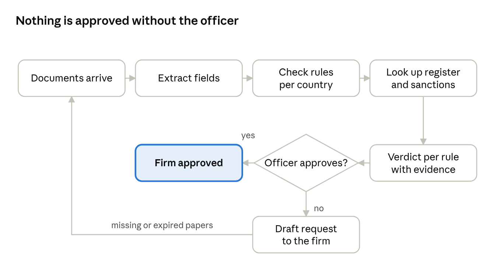
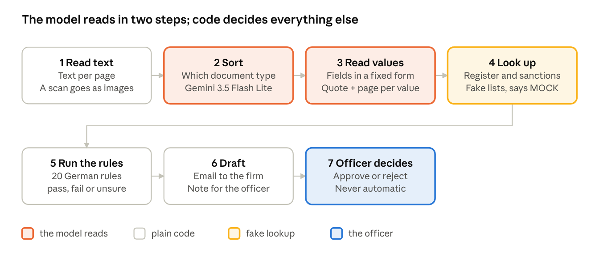
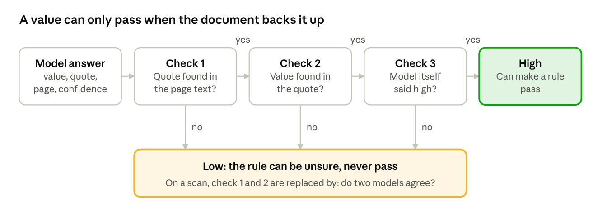
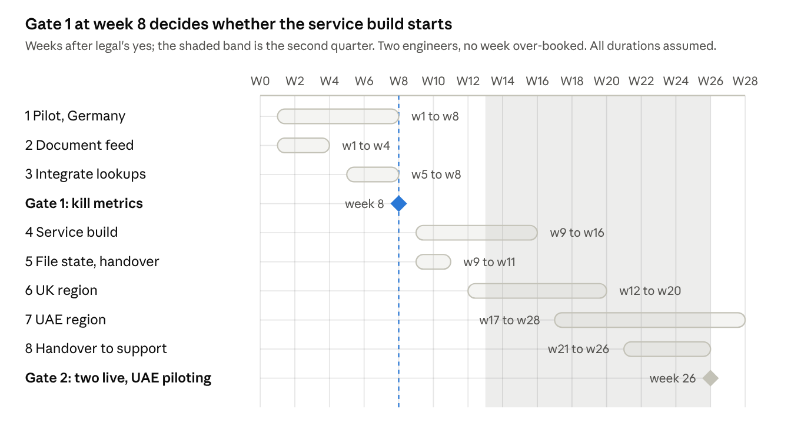
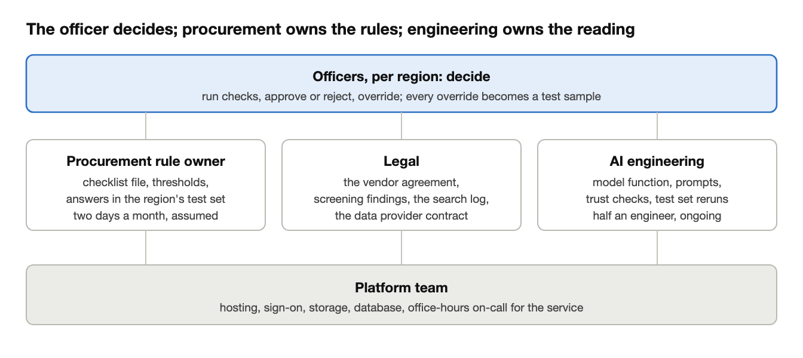
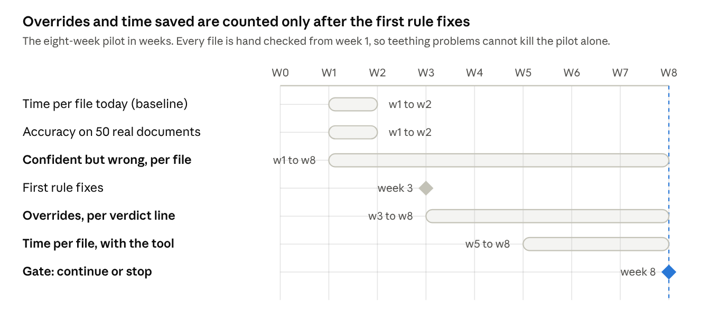

# NIG Supplier Check: Technical Design

Nov 10, 2026 · Luuk Peterse

This document covers the use case, the design, how I know it works, the path to production, and the kill test. The executive summary stands on its own. The code is at https://github.com/DevLuuk/supplier-qualification-check; the README gets you from clone to demo.

## 1. The user and the flow

The user is a compliance officer for one region. Before a subcontractor may work on a site, she checks its papers:

1. register extract
2. insurance
3. ISO 9001 and ISO 45001 (quality and safety certificates)
4. safety record and bank letter

Today she opens 8 to 12 PDFs, copies dates and numbers into a spreadsheet checklist, looks the firm up in the register and the sanctions list (firms NIG may not work with), and emails the firm for what is missing. Two to four hours per firm, spread over weeks of waiting (assumed).

I am new to construction procurement. The document list, the amounts and the hours are my guesses, written down so someone who knows better can correct them.

With the tool, five of the six steps move to the tool. The decision stays with the officer, and anything not approved gets a ready-made email to the firm.

Why this use case: it is a qualification check, which the case names as an example. It is not contract review (no clauses are judged) and not invoice processing (no amounts are paid). Its hard part, getting reliable data out of messy documents and knowing how often you are wrong, is work I have done in production.

## 2. How it is built

Seven steps in a fixed order. Two are model calls, the rest is plain code.

| Part | Bought or built | Why |
| --- | --- | --- |
| Reading the documents | Bought: Gemini 3.8 Flash. Gemini 3.5 Flash Lite sorts document types and is the second reader on scans | Priced service. The value is in what we ask and how we check the answer |
| Text out of a PDF | Bought: pypdf, open source | Solved problem. Scans go to the model as page images |
| The fixed forms the values go into | Built: small pydantic models | Specific to NIG's papers; everything else depends on them |
| The country checklists | Built: plain Python, one file per country | NIG's own knowledge. Every line must be explainable in an audit |
| Register and sanctions lookups | Mocked now, bought in production | The lists change daily and carry legal weight |
| The review screen | Built: one thin Streamlit page | Where trust is won or lost |
| The eval | Built: answer key per firm plus a script | Vendor tools do not know our fields |
| The glue | Built: plain Python, no agent framework | Seven fixed steps do not need one. A framework earns its place when the next step depends on what the model found |

Size: About 2,100 lines of Python, 127 tests.

All model calls go through one function: schema in, checked object out, answer cached, cost logged. Swapping the vendor is that one file (not tested). Temperature 0, low thinking: on all 170 fields it scored the same as normal thinking at four to seven times less cost (measured).

## 3. How a value earns trust

The model never decides pass or fail. It only copies values out of the document. Every value then gets a confidence, high or low, and code decides it:

1. The model returns the value, the sentence it found it in, and the page.
2. Code searches the page text for that sentence. Not found: low.
3. Code searches that sentence for the value. Dates and amounts are normalised first, so "EUR 5 Mio." counts as 5,000,000. Not found: low.
4. The model also rates itself. If it says low: low.
5. Otherwise: high.

Only a high confidence value can make a rule pass. A low one can make a rule unsure, never pass. A missing value makes its rule unsure.

Scans have no text layer to search, so steps 2 and 3 cannot run. A scan is read twice by two different models instead, and a value is high only when both readings agree.

The rules are code. Germany has 20 rules in seven groups:

- documents present
- register number and name
- insurance valid and high enough and running 30 more days
- ISO certificates valid
- zero fatalities in three years
- no sanctions match
- bank account holder matches

Unsure is a real answer: a missing value, a name that almost matches, a date it could not read. Register and sanctions findings never reach the firm's email; telling a firm it is on a sanctions list can be illegal.

## 4. How I know it works

Every mock firm has a hand-checked answer key. A script compares every read value and counts three things per field type: right, wrong but marked unsure (the safe kind), and wrong while sure (the kind that flips a verdict). Measured 8 November 2026, full table in `docs/eval_report.md`:

| Firm | Planted problem | Fields right | Wrong while sure | Caught |
| --- | --- | --- | --- | --- |
| Hansen | none | 35 of 35 | 0 | n/a |
| Weber | expired insurance | 35 of 35 | 0 | 1 of 1 |
| Müller | name mismatch, missing certificate, low cover | 29 of 29 | 0 | 6 of 6 |
| Baltic | scanned certificate, cover letter | 35 of 35 | 0 | 4 of 4 |
| Nordhaus | fraud-shaped: register number of another firm | 36 of 36 | 0 | 4 of 4 |

Cost per firm: 0.66 to 1.03 rappen (about 0.01 CHF), measured.

What this does not tell: the PDFs are clean generated text, the planted problems are the ones I thought of, and the scan sample is one document. The pilot's first two weeks rerun the same script on 50 real documents. That number decides, not this one.

Failure cases I saw, as they happened:

1. The second reader on the scan returned the insurer's letterhead address as the insured address. The reads disagreed, the field stayed unsure, the officer sees both.
2. The same scan an hour later gave a different answer at temperature 0. Hence two reads, a cache, and a pinned model version in production.
3. The first email draft listed the sanctions match. Caught in review; now screening rules are internal only and a test checks the email.
4. The first version checked the quote but not the value in it. Fixed with the value-in-quote check.
5. Fuzzy name matching scored the fraud-shaped firm a perfect match. Register check now uses a stricter score; the sanctions check stays loose so near misses reach the officer.
6. Free-tier rate limits and an hour of 504 errors. Retries, cache and a paid tier.

What I would change first: run the eval on real documents, add one trace per run, test the vendor swap once, replace the name thresholds with ones from pilot overrides.

## 5. Path to production

Two quarters and two weeks, two engineers, two gates. Three things must be true before the pilot clock starts:

1. A rule owner in procurement who owns the checklist and answers within a week.
2. Legal's yes on sending supplier documents to a model vendor, six to ten weeks (assumed). Starts now.
3. A data provider contract for the register and the sanctions list.

What production adds that the prototype lacks: a mailbox or portal in, a decision record per firm written back to the region's procurement system, sign-on with three roles (officer, legal, rule owner), a database with every verdict and override, one trace per run, keys in a vault, and a vendor account with a data agreement in the project's region.

- **Data**. Documents hold personal data and stay in NIG's storage in the project's region. The asset that outlives every model is the test set: 50 real anonymised documents per region, and every override is one more labelled sample.
- **Security**. The model only copies values and has no tools, so text inside a document that tries to steer it can at most produce a wrong value, which cannot pass a rule.
- **Reliability**. The tool is not on the critical path: when it is down, the officer checks by hand. So office-hours support, no on-call. A run that cannot finish shows "not checked", never a half list.
- **Cost**. The model is a few hundred francs a year at any volume, even after the price doubles on 1 January 2027. The cost is people: half an engineer (100,000 CHF), rule owners at two days a month per region (about 310,000 CHF at 20 regions), hosting 4,000 to 7,000 CHF, data licences not yet quoted. All assumed.
- **Countries**. A new country is a rule file, a rule owner and a test set. Germany first, the UK second, the UAE last after a one-week spike on real Arabic documents.
- **Ownership**. Procurement owns the rules. Engineering owns the reading. Only the officer owns the decision.

Gate 1 at week 8: the three stop lines below are inside, or nothing after week 8 starts. Gate 2 at week 26: Germany and the UK live, the UAE piloting, support handed over. A monthly blind audit (the rule owner re-checks a random sample of approved files) runs next to the override rate, because officers who approve without reading make the override rate look perfect.

## 6. Assumptions and kill test

| Assumption | Why it matters | How I check it | If false |
| --- | --- | --- | --- |
| The tool reads the fields that decide a verdict from real PDFs almost always right, and says so when unsure | A wrong date that looks valid is the one mistake the officer will not catch | 50 real documents in weeks 1 to 2, every field checked by hand | One reading template per insurer, or limit the tool to the document types it reads well |
| Officers trust a line with its proof quote and do not re-read every document | If they re-read everything, nothing is saved | Sit with five officers for a week; time per file; how often they open the PDF | The product becomes a pre-filled checklist with a smaller saving |
| The checklists can be written as clear rules and someone owns them | Rules as code is why every verdict is explainable | Ask three regions for their checklist; count crisp items versus judgement calls | Crisp rules in code, judgement calls to the officer as unsure |

Three stop lines, measured in a pilot with 100 real files over eight weeks. If one is crossed we stop or redesign; we do not keep tuning.

| Metric | Window | Stop if |
| --- | --- | --- |
| Wrong while sure, and the verdict flips | Weeks 1 to 8, every file hand checked | More than 5% of files |
| Verdict lines the officer overrides after reading the proof | Weeks 3 to 8, after first rule fixes | More than 25% of lines |
| Officer time per file saved against the weeks 1 to 2 baseline | Weeks 5 to 8 | Less than 30% |

Why these lines: 5% is five files, a pattern; 2% is two files, bad luck. 25% of lines wrong is a design problem, not tuning. At 30% saved the saving roughly equals the running cost, so it is the floor, not the target. Warning sign, not a stop line: more than 40% of lines still unsure after week 4 (measured on the five mock firms: 9 of their 100 verdict lines).
