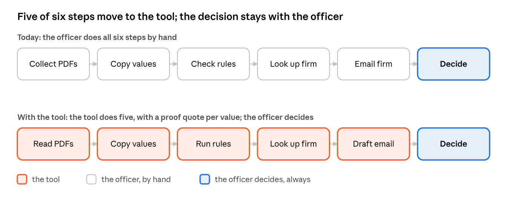

# NIG Supplier Check: Executive Summary

Nov 10, 2026 · Luuk Peterse

Every subcontractor that walks onto an NIG site was cleared by one person reading a stack of PDFs by hand. Expired insurance and wrong names slip through, and we find out when the firm is already working.

I built a tool that reads those papers, checks them against the country's rules, and shows the compliance officer one line per rule with the proof. She still decides every firm.

The ask: an eight-week pilot in one region, one engineer full time plus one day a week of an officer's time, about 35,000 CHF (assumed). It ends with three numbers that say continue or stop.

## The problem

Before a scaffolder or crane firm may start, the officer checks its register extract, insurance, two ISO certificates, safety record and bank letter. Eight to twelve PDFs per firm, two to four hours of work, a different checklist per country (all assumed).

## The tool

One line per rule: pass, fail or unsure, each with the sentence from the PDF that proves it. Nothing is approved without the officer.

## What the prototype showed

Built in about ten hours. Run on five made-up German firms with the hard cases planted: an expired insurance, a name mismatch, a missing certificate, a scan, a fraud-shaped firm. All measured on 8 November 2026.

- 170 of 170 values read right, 0 read wrong while sure.
- 15 of 15 planted problems caught.
- About 0.01 CHF and under 30 seconds of model time per firm.

The mock PDFs are clean. This proves the method, not real scans. The pilot's first two weeks measure that on 50 real documents.

## Value

Every factor is assumed and the pilot must confirm it.

- 20 regions, 20 new firms each per month: 4,800 firms a year.
- 3 officer hours per firm, half of it saved: 7,200 hours a year.
- At 80 CHF an hour: about 580,000 CHF a year.

Running cost at 20 regions is about 420,000 CHF a year before data licences, mostly people: half an engineer, and in each region a rule owner (one person in procurement who owns the country checklist). Build is about 200,000 CHF once. Payback about fifteen months after full rollout. With three regions the tool does not pay, so the real decision comes after quarter two, on pilot numbers.

The second return is risk: an uninsured firm that never reaches the site. One avoided incident is worth more than a year of saved hours.

## What stops it

Three stop lines, measured on 100 real files over eight weeks:

- The tool reads a value wrong while sure, and the verdict flips, in more than 5% of files.
- Officers change more than 25% of verdict lines after reading the proof.
- Less than 30% of officer time per file is saved.

Honest risks: real documents read worse than mock ones; officers re-read everything anyway, or approve without reading; legal says no to sending documents to a model vendor; nobody owns the rules.

## Rollout

Three things first: a rule owner in procurement, legal's yes (six to ten weeks, assumed), a data provider for the company register and the sanctions list (firms NIG may not work with).

1. Weeks 1 to 8: pilot in Germany. Gate 1: the three stop lines above all hold, or nothing else starts.
2. Weeks 9 to 16: login, database, audit trail.
3. Weeks 12 to 28, second engineer in parallel: the UK, then the UAE after a one-week test on Arabic documents. Gate 2 at week 26: Germany and the UK live.

Two quarters and two weeks, two engineers, three things.

The code, the design document and the eval report are at https://github.com/DevLuuk/supplier-qualification-check. The demo video (8 minutes) is at https://drive.proton.me/urls/01QJCNNHT8#kLMQ8TTlkSlK.
